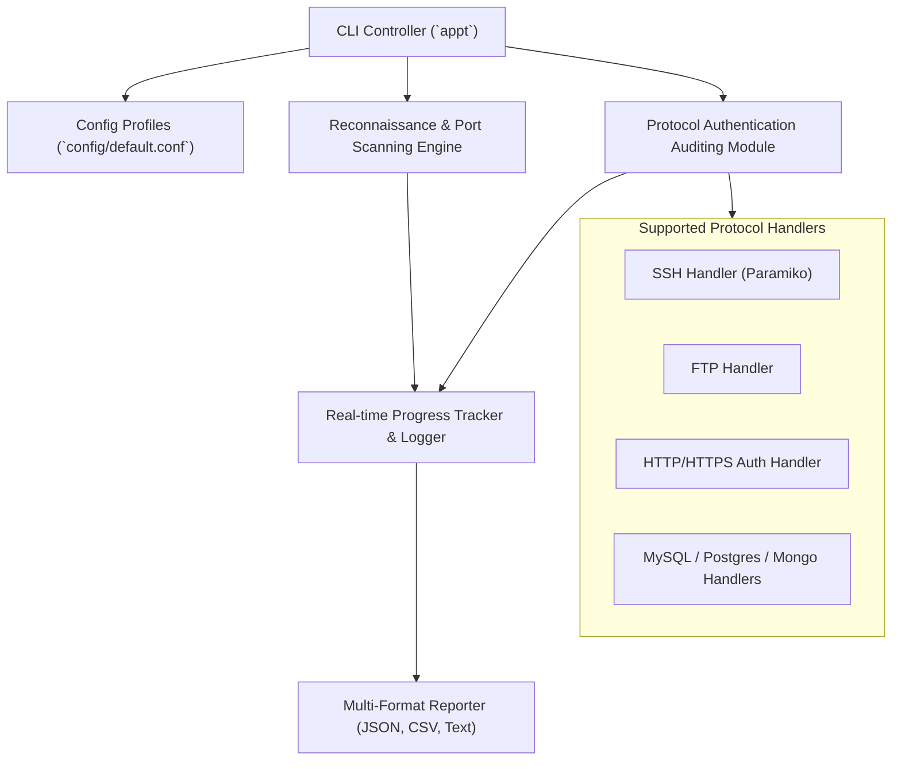

# Advanced Penetration Testing Toolkit (APPT) v2.1

[](https://www.python.org/)
[](https://www.docker.com/)
[](#)
[](LICENSE)

**APPT (Advanced Penetration Testing Toolkit)** is a modular, high-throughput network security auditing and credential stress-testing framework. Inspired by Hydra and Nmap, APPT combines multi-threaded port and service fingerprinting, credential dictionary attacks across multiple network protocols, rich session logging, and multi-format forensic reporting (JSON, CSV, HTML).

---

## 📸 Interface & Terminal Preview

<div align="center">
  
</div>

---

## 🌟 Key Capabilities

### 1. High-Performance Reconnaissance & Port Scanning
- **Concurrent Threading**: Multi-worker thread pools with adaptive socket timeouts (100+ ports/sec).
- **Service Fingerprinting**: Automatic banner retrieval across common TCP/UDP ports (SSH, FTP, HTTP/S, SMTP, Telnet, MySQL, PostgreSQL, MongoDB).
- **Target Flexibility**: Supports individual hostnames, IPv4 addresses, and batch target lists (`targets.txt`).

### 2. Multi-Protocol Credential Auditing (Hydra-Style)
- **Supported Protocols**: SSH, FTP, HTTP Basic/Digest, HTTPS, Telnet, MySQL, PostgreSQL, MongoDB.
- **Attack Modes**:
  - `single`: One password per user (data breach verification).
  - `loop`: All dictionary passwords per target user.
  - `combo`: Paired user:password combinations.
- **Smart Rate Limiting**: Anti-lockout delay throttles and jitter randomization to evade intrusion prevention thresholds during authorized audits.

### 3. Reporting & Operational Telemetry
- **Multi-Format Export**: Generates audit deliverables in JSON, CSV, and formatted text.
- **Real-Time Progress**: Live terminal metrics with probes per second, active worker counts, and calculated ETA.

---

## 🏗️ Architecture & Component Layout



---

## 📁 Repository Structure

```text
├── appt                        # Executable CLI launcher
├── Dockerfile                  # Containerized deployment manifest
├── docker-compose.yml          # Container orchestration configuration
├── Screenshot 2025-06-17...png # Terminal execution screenshot
├── src/                        # Core toolkit source code
│   ├── port_scanner.py         # Threaded port scanner & banner grabber
│   ├── brute_forcer.py         # Protocol handlers (SSH, FTP, HTTP)
│   └── utils.py                # Input validation, networking utilities
├── wordlists/                  # Curated auditing dictionary assets (passwords.txt, usernames.txt)
├── config/                     # Configuration file (`default.conf`)
├── examples.py                 # Programmatic Python API usage examples
├── USER_MANUAL.md              # Complete 1,000+ line user operations manual
├── CODE_WALKTHROUGH.md         # Detailed code walkthrough & module internals
└── docs/README.md              # Technical documentation
```

---

## 🚀 Installation & Quickstart

### Prerequisites
- Python 3.9+
- Network access to authorized target systems

### 1. Local Python Setup
```bash
# Clone the repository
git clone https://github.com/JEFFERSON-007/APPT.git
cd APPT

# Install dependencies
pip install -r requirements.txt

# Make launcher executable (Linux/macOS)
chmod +x appt

# Run the interactive CLI
./appt --help
```

### 2. Docker Deployment
```bash
# Build and run using Docker Compose
docker compose up -d

# Execute commands within the container
docker compose exec appt python appt -t 127.0.0.1 -p 22,80,443
```

---

## 📖 Command Usage Examples

### Port Scanning
```bash
# Scan common ports on target
./appt scan 192.168.1.1 --quick

# Scan specific port range with 50 threads
./appt scan 192.168.1.1 -p 1-10000 -t 50

# Save structured output to JSON
./appt scan 192.168.1.1 -p 80,443,22,21 --json -o results.json
```

### Credential Auditing
```bash
# SSH dictionary audit for single user
./appt brute 192.168.1.100 --protocol ssh -u admin -w wordlists/passwords.txt

# Multi-user FTP audit with rate limiting
./appt brute 192.168.1.100 --protocol ftp -U wordlists/usernames.txt -w wordlists/passwords.txt --delay 0.5

# Stop on first successful authentication
./appt brute 192.168.1.100 -u admin --stop-on-success
```

---

## 📚 Documentation Links
- [Comprehensive User Manual](../USER_MANUAL.md) — 10-chapter deep dive into advanced configurations.
- [Code Architecture Walkthrough](../CODE_WALKTHROUGH.md) — Module connections, design patterns, and class structures.
- [Bug Fixes & Changelog](../BUG_FIXES.md) — History of stability updates.

---

## ⚖️ Legal Disclaimer

> [!CAUTION]
> The Advanced Penetration Testing Toolkit (APPT) is designed exclusively for **authorized security testing, educational research, and defensive evaluation**. Performing credential testing or unauthorized port scanning against systems without explicit, documented permission is strictly prohibited.

---

## 👤 Author
Developed by **[JEFFERSON RAJA A](https://github.com/JEFFERSON-007)**  
*Cybersecurity Engineering & Offensive Security Research.*
